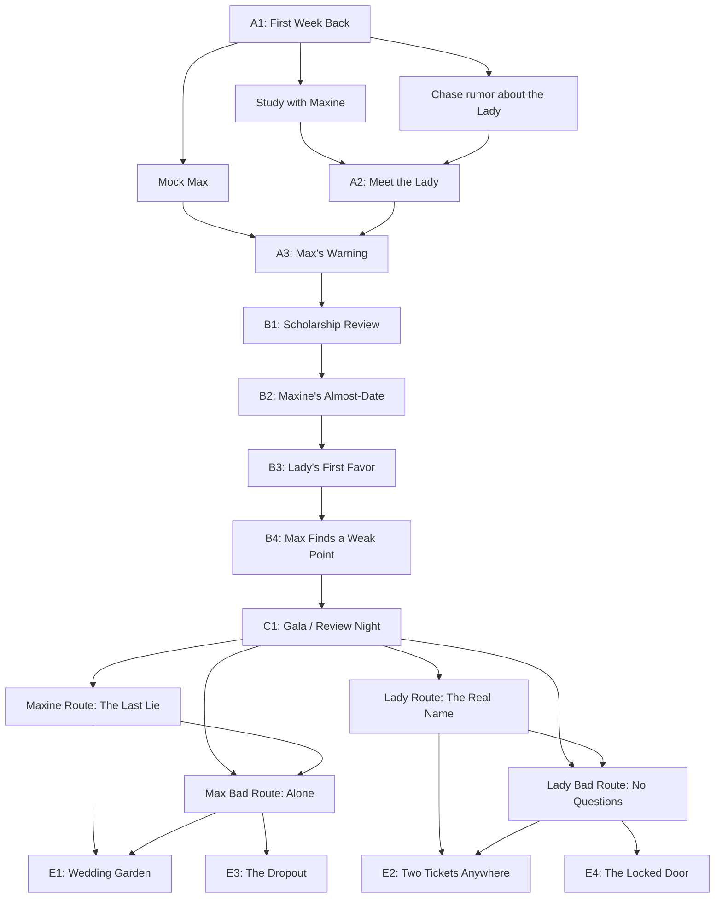

# Plot Tree and Choice Design

Working method: start from the four endings, then build backward so every major choice pushes the MC toward a visible consequence.

## Ending Targets

### E1: Maxine Happy End - "The Wedding Garden"

The MC chooses honesty, commitment, and long-term stability. He graduates, reconciles the damage caused by Max, and marries Maxine after they both choose a future that is bigger than the college drama.

Required emotional promise:
- Maxine feels chosen, not won.
- The MC admits his mistakes before they are exposed.
- Max is confronted without the MC becoming cruel or reckless.
- College remains part of the future instead of something he escapes.

Final image:
- A small outdoor wedding after graduation.
- Maxine teases the MC about still being nervous.
- The MC realizes love is not the end of adventure, it is the place he can return to.

Route requirements:
- `maxine_trust` high
- `integrity` high
- `max_rage` not extreme
- `college_stability` intact
- Final choice: "Stay and build a life with Maxine."

### E2: Lady Happy End - "Two Tickets Anywhere"

The MC chooses freedom, curiosity, and emotional honesty with the Lady. He does not become her pawn; he becomes her partner. They leave together to travel the world, with the MC closing his college life cleanly instead of vanishing from it.

Required emotional promise:
- The Lady reveals enough truth for the relationship to feel mutual.
- The MC refuses illegal shortcuts but accepts uncertainty.
- Maxine is not humiliated or used as a backup option.
- The MC chooses travel as a life, not as an escape from consequences.

Final image:
- The MC and the Lady board a late-night train or plane with two open-ended tickets.
- She asks where he wants to go first.
- He says, "Somewhere we have to learn as we go."

Route requirements:
- `lady_trust` high
- `integrity` medium or high
- `lady_heat` low or contained
- `maxine_trust` resolved cleanly, even if romance ends
- Final choice: "Leave with her, but only clean."

### E3: Max Bad End - "The Dropout"

The MC lies, escalates conflict with Max, and loses the support network that could protect him. Max beats him badly enough that the scandal wrecks his scholarship and he drops out of college.

Required emotional warning:
- This ending is not just "Max is violent."
- It is the result of the MC feeding Max's rage, hiding from Maxine, and making college enemies.
- The player should see the danger coming but believe they can still avoid it until the last bad choice.

Final image:
- The MC leaves campus with a bruised face, a half-packed bag, and an unread message from Maxine.
- He tells himself college was never his place, but the narration makes it clear he is lying.

Route requirements:
- `max_rage` extreme
- `maxine_trust` low
- `college_stability` broken
- `integrity` low
- Final choice: "Meet Max alone."

### E4: Lady Bad End - "The Locked Door"

The MC trusts the Lady blindly, accepts a dangerous favor, and becomes the easy person to blame when her illegal life catches up with them. He ends up in jail.

Required emotional warning:
- The Lady is not a cartoon villain.
- The MC wants to believe mystery equals romance, so he ignores practical danger.
- The player should understand the difference between choosing adventure and surrendering judgment.

Final image:
- The MC sits in a holding cell, hearing travel announcements through a tiny TV in the corner.
- The Lady is gone, or unreachable, and the passport he thought was freedom is now evidence.

Route requirements:
- `lady_trust` high but unhealthy
- `lady_heat` extreme
- `integrity` low
- `college_stability` ignored
- Final choice: "Carry the envelope and ask no questions."

## Core Variables

These are the story flags the choices should manipulate.

| Variable | Meaning | Raised By | Lowered By |
| --- | --- | --- | --- |
| `maxine_trust` | Maxine believes the MC respects her and tells the truth. | Honest talks, defending her boundaries, choosing her openly. | Flirting behind her back, lying, using her to make Max jealous. |
| `lady_trust` | The Lady opens up and treats the MC as a real partner. | Curiosity, discretion, refusing to judge her past too quickly. | Public accusations, choosing safety without compassion, betraying secrets. |
| `integrity` | The MC keeps his moral center under pressure. | Telling hard truths, refusing shortcuts, taking responsibility. | Lying, cheating, hiding evidence, accepting dirty favors. |
| `max_rage` | Max feels humiliated, threatened, and ready to hurt the MC. | Taunting him, public embarrassment, secret meetings with Maxine. | De-escalation, witnesses, refusing macho contests. |
| `college_stability` | The MC can remain enrolled and supported. | Attending class, keeping scholarship safe, asking faculty for help. | Skipping obligations, scandals, fights, illegal activity. |
| `lady_heat` | Legal danger around the Lady gets closer to the MC. | Moving packages, forged documents, lying to police. | Refusing illegal errands, asking direct questions, keeping receipts. |

## Backward Route Logic

### One Step Before E1: Maxine Commitment Test

Scene: Graduation garden, after Max has made one last attempt to poison Maxine against the MC.

Choice:
- "Tell Maxine everything before Max does." -> E1 path, raises `maxine_trust`, raises `integrity`.
- "Hide the Lady's involvement and propose now." -> blocks E1, lowers `integrity`, risks E3.
- "Say college was a mistake and run." -> blocks E1, shifts toward Lady routes.

Needed setup:
- The MC must have one real secret left to confess.
- Maxine must already have seen enough good in him to hear it.
- Max must still be dangerous, but not in full control.

### One Step Before E2: The Clean Escape Test

Scene: Train station or airport. The Lady has tickets, but there is also one last risky errand that would make the trip easier.

Choice:
- "Leave with her, but refuse the errand." -> E2 path, lowers `lady_heat`, preserves `integrity`.
- "Do the errand so she will never leave you." -> E4 path, raises `lady_heat`, lowers `integrity`.
- "Call Maxine for help." -> possible Maxine recovery branch if `maxine_trust` is not too low.

Needed setup:
- The Lady must trust the MC enough to offer the truth.
- The player must know the errand is suspicious.
- The MC must have the option to travel without becoming an accessory.

### One Step Before E3: Max's Trap

Scene: Max texts the MC to meet behind the gym or near the parking structure.

Choice:
- "Meet Max alone." -> E3 if `max_rage` extreme and `college_stability` broken.
- "Bring witnesses and refuse the fight." -> reduces `max_rage`, can recover toward E1.
- "Send the messages to campus security." -> raises `college_stability`, raises `integrity`, may anger Max but protects MC.

Needed setup:
- Max has been publicly humiliated at least once.
- The MC has few allies if he has lied to Maxine and skipped obligations.
- College administration is already watching the MC.

### One Step Before E4: The Envelope

Scene: The Lady asks the MC to carry an envelope, passport, or drive a borrowed car across town without questions.

Choice:
- "Carry it and ask no questions." -> E4 if `lady_heat` extreme and `integrity` low.
- "Open it and confront her." -> risky but can recover toward E2.
- "Walk away and call a lawyer/faculty mentor." -> breaks Lady romance, restores `college_stability`.

Needed setup:
- The MC has accepted smaller secrets before.
- He has already lied for the Lady once.
- Police, campus security, or a rival has been circling the case.

## Act Structure

### Act 1: The Triangle Opens

Goal: Introduce Maxine as warmth and stability, the Lady as danger and freedom, and Max as the pressure point.

Scene A1 - First Week Back
- The MC returns to college under scholarship pressure.
- Maxine helps him settle in and clearly knows the campus better than he does.
- Max appears as someone who already feels entitled to Maxine's attention.

Choice A1:
- "Thank Maxine and ask to study together." -> `maxine_trust +1`, `college_stability +1`
- "Brush her off and chase the rumor about the Lady." -> `lady_trust +1`, `college_stability -1`
- "Mock Max in front of everyone." -> `max_rage +2`, `integrity -1`

Scene A2 - The Lady at the Edge of Campus
- The MC meets the Lady off campus, maybe near a gallery, hotel bar, old bookshop, or train station.
- She knows something about the college scandal that nobody else mentions.
- She tests whether the MC wants truth or just fantasy.

Choice A2:
- "Ask what she wants from you." -> `integrity +1`, unlocks healthy Lady route
- "Flirt and avoid the question." -> `lady_trust +1`, `integrity -1`
- "Tell Maxine immediately." -> `maxine_trust +1`, Lady route slows but stays open

Scene A3 - Max's Warning
- Max corners the MC and warns him to stay away from Maxine.
- This is the first chance to set the tone of their conflict.

Choice A3:
- "Walk away without performing fear." -> `integrity +1`, `max_rage +1`
- "Tell Maxine what happened." -> `maxine_trust +1`, `college_stability +1`
- "Threaten Max back." -> `max_rage +2`, E3 seed

### Act 2: Secrets Become Choices

Goal: Force the MC to choose how he handles secrecy, not yet whom he loves.

Scene B1 - The Scholarship Review
- The MC is warned that absences, fights, or scandals could end his place at college.
- This gives the bad endings mechanical weight.

Choice B1:
- "Take the review seriously." -> `college_stability +2`
- "Ask Maxine for help preparing." -> `maxine_trust +1`, `college_stability +1`
- "Skip it to meet the Lady." -> `lady_trust +1`, `college_stability -2`

Scene B2 - Maxine's Almost-Date
- Maxine invites the MC to something sincere: a club event, a late library session, a campus festival.
- The Lady sends a message at the same time.

Choice B2:
- "Stay with Maxine and silence the phone." -> `maxine_trust +2`, `lady_trust -1`
- "Tell Maxine the truth and go check on the Lady." -> `integrity +1`, `maxine_trust +0`, `lady_trust +1`
- "Lie to Maxine and leave." -> `maxine_trust -2`, `integrity -1`, E3/E4 seed

Scene B3 - The Lady's First Favor
- The Lady asks for something small but questionable: return a key, deliver a note, delete a photo, lie about seeing her.

Choice B3:
- "Help only after she explains." -> `lady_trust +1`, `integrity +1`, `lady_heat -1`
- "Do it without asking." -> `lady_trust +1`, `integrity -1`, `lady_heat +1`
- "Refuse and warn her this is dangerous." -> `integrity +1`, `lady_trust -1`, keeps E2 possible if compassionate

Scene B4 - Max Finds a Weak Point
- Max learns the MC lied to someone, skipped review, or met the Lady.
- He tries to use that information to isolate the MC from Maxine.

Choice B4:
- "Confess to Maxine before Max can twist it." -> `maxine_trust +2`, `integrity +1`
- "Beg Max to keep quiet." -> `max_rage +1`, `integrity -1`
- "Humiliate Max publicly." -> `max_rage +3`, E3 strong seed

### Act 3: Routes Lock

Goal: The player now chooses a worldview: commitment, clean freedom, violent pride, or blind escape.

Scene C1 - The Gala / Review Night
- A campus event puts Maxine, Max, the Lady, and the scholarship committee in the same orbit.
- This is the route-lock scene.

Choice C1:
- "Stand beside Maxine openly." -> Maxine route lock if `maxine_trust >= 4`
- "Step outside with the Lady and demand the truth." -> Lady route lock if `lady_trust >= 3` and `integrity >= 1`
- "Chase Max after his insult." -> Max bad route lock if `max_rage >= 5`
- "Cover for the Lady's suspicious contact." -> Lady bad route lock if `lady_heat >= 3`

Scene C2M - Maxine Route: The Last Lie
- The MC has to decide whether to confess every secret.
- Max tries to interrupt with proof.

Choice C2M:
- "Confess first." -> prepares E1
- "Attack Max's reputation instead." -> risks E3
- "Leave Maxine in the dark." -> blocks E1

Scene C2L - Lady Route: The Real Name
- The Lady reveals part of her real past and asks whether the MC can live without certainty.

Choice C2L:
- "Choose her, but set boundaries." -> prepares E2
- "Promise to do anything." -> prepares E4
- "Ask for time to end things with Maxine cleanly." -> raises `integrity`, keeps E2 healthy

Scene C2B - Max Bad Route: Alone
- Max sends the meeting text.
- The MC is angry, isolated, and close to losing school.

Choice C2B:
- "Meet Max alone." -> E3
- "Send proof to campus security." -> escape hatch to neutral or Maxine recovery
- "Call Maxine." -> possible E1 recovery if trust is not destroyed

Scene C2J - Lady Bad Route: No Questions
- The Lady needs the MC to carry the envelope.
- Police pressure is nearby.

Choice C2J:
- "Carry it and ask no questions." -> E4
- "Open it." -> confrontation, possible E2 recovery
- "Leave it and walk away." -> neutral survival ending

## Full Choice Tree



## Choice ID Reference

Use these IDs later if the story becomes Ren'Py labels, Ink knots, Twine passages, or JSON.

| ID | Scene | Player Choice | Main Effect |
| --- | --- | --- | --- |
| `A1_STUDY_MAXINE` | First Week Back | Thank Maxine and ask to study together. | Maxine route seed |
| `A1_FIND_LADY` | First Week Back | Brush her off and chase the rumor about the Lady. | Lady route seed |
| `A1_MOCK_MAX` | First Week Back | Mock Max in front of everyone. | Max bad seed |
| `A2_DIRECT_QUESTION` | The Lady at the Edge | Ask what she wants from you. | Healthy Lady seed |
| `A2_FLIRT_DODGE` | The Lady at the Edge | Flirt and avoid the question. | Unhealthy Lady seed |
| `A2_TELL_MAXINE` | The Lady at the Edge | Tell Maxine immediately. | Maxine trust seed |
| `A3_WALK_AWAY` | Max's Warning | Walk away without performing fear. | Integrity seed |
| `A3_TELL_MAXINE` | Max's Warning | Tell Maxine what happened. | Maxine trust, college safety |
| `A3_THREATEN_MAX` | Max's Warning | Threaten Max back. | Max bad seed |
| `B1_REVIEW_SERIOUSLY` | Scholarship Review | Take the review seriously. | College stability |
| `B1_ASK_MAXINE` | Scholarship Review | Ask Maxine for help preparing. | Maxine trust and stability |
| `B1_SKIP_FOR_LADY` | Scholarship Review | Skip it to meet the Lady. | Lady trust, college danger |
| `B2_STAY_MAXINE` | Almost-Date | Stay with Maxine and silence the phone. | Strong Maxine push |
| `B2_TRUTH_GO` | Almost-Date | Tell Maxine the truth and go check on the Lady. | Integrity, keeps both routes open |
| `B2_LIE_LEAVE` | Almost-Date | Lie to Maxine and leave. | Bad route seed |
| `B3_EXPLAIN_FIRST` | First Favor | Help only after she explains. | Healthy Lady push |
| `B3_NO_QUESTIONS` | First Favor | Do it without asking. | Jail seed |
| `B3_REFUSE_KINDLY` | First Favor | Refuse and warn her this is dangerous. | Integrity, route tension |
| `B4_CONFESS_MAXINE` | Max Finds Weak Point | Confess to Maxine before Max can twist it. | Maxine recovery |
| `B4_BEG_MAX` | Max Finds Weak Point | Beg Max to keep quiet. | Max gains power |
| `B4_HUMILIATE_MAX` | Max Finds Weak Point | Humiliate Max publicly. | Dropout seed |
| `C1_LOCK_MAXINE` | Gala | Stand beside Maxine openly. | Maxine route lock |
| `C1_LOCK_LADY` | Gala | Step outside with the Lady and demand the truth. | Lady route lock |
| `C1_CHASE_MAX` | Gala | Chase Max after his insult. | Max bad route lock |
| `C1_COVER_LADY` | Gala | Cover for the Lady's suspicious contact. | Jail route lock |
| `C2M_CONFESS` | Last Lie | Confess first. | Wedding ending |
| `C2M_ATTACK_MAX` | Last Lie | Attack Max's reputation instead. | Dropout danger |
| `C2L_BOUNDARIES` | Real Name | Choose her, but set boundaries. | Travel ending |
| `C2L_ANYTHING` | Real Name | Promise to do anything. | Jail danger |
| `C2B_MEET_ALONE` | Alone | Meet Max alone. | Dropout ending |
| `C2B_SECURITY` | Alone | Send proof to campus security. | Escape bad ending |
| `C2J_CARRY` | No Questions | Carry it and ask no questions. | Jail ending |
| `C2J_OPEN` | No Questions | Open it and confront her. | Travel recovery |

## Ending Conditions

These thresholds are adjustable once we know how many scenes the first build will include.

```text
E1 Wedding Garden:
  maxine_trust >= 5
  integrity >= 3
  college_stability >= 2
  max_rage <= 5
  final_choice == C2M_CONFESS

E2 Two Tickets Anywhere:
  lady_trust >= 4
  integrity >= 2
  lady_heat <= 3
  final_choice == C2L_BOUNDARIES or C2J_OPEN

E3 The Dropout:
  max_rage >= 6
  college_stability <= -2
  maxine_trust <= 1
  final_choice == C2B_MEET_ALONE

E4 The Locked Door:
  lady_heat >= 4
  integrity <= 0
  final_choice == C2J_CARRY
```

## Neutral Fallbacks

These are not the requested core endings, but they help prevent the game from feeling binary if scores land in the middle.

### N1: "Transfer Papers"

The MC survives the semester but leaves the college by choice or necessity. He does not end up with Maxine or the Lady, but he has enough self-respect to start again.

Trigger:
- No romance route meets happy thresholds.
- `integrity >= 2`
- `college_stability` not completely broken.

### N2: "Summer Alone"

The MC stays in college but loses both romances. Maxine will not trust him, and the Lady decides he is not brave enough for her world.

Trigger:
- `maxine_trust` low
- `lady_trust` low or `lady_heat` contained
- `college_stability >= 1`

## Writing Priorities

1. Make Maxine's happy route about honesty, not just choosing the "nice girl."
2. Make the Lady's happy route about freedom with boundaries, not blind escape.
3. Make Max's bad ending feel avoidable until the MC chooses pride one time too many.
4. Make the Lady's jail ending feel like the dark mirror of her happy route: same romance, no judgment.
5. Keep college pressure active in every route so the dropout and jail endings feel tied to the premise.

## Next Scenes To Write First

Start with these because they connect most strongly to the endings:

1. C2M - Maxine Route: The Last Lie
2. C2L - Lady Route: The Real Name
3. C2B - Max Bad Route: Alone
4. C2J - Lady Bad Route: No Questions
5. C1 - Gala / Review Night

After those work, write backward into Act 2, then Act 1.
