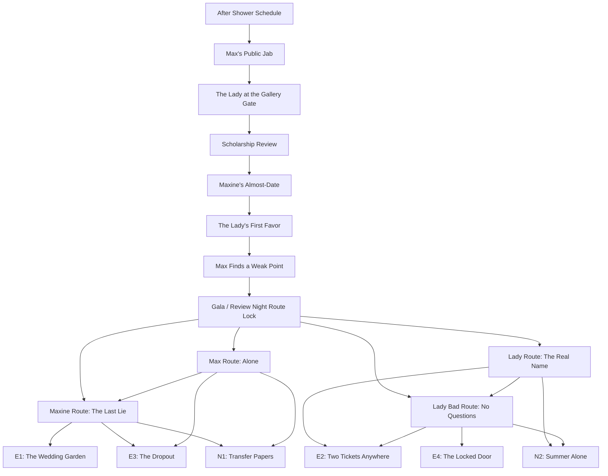

# Route Choice Tree

This route expansion starts after Clara creates Sam's shower schedule. It turns the prototype setup into a compact playable route map with four core endings and two neutral fallbacks.

## Core Endings

### E1 - The Wedding Garden

Sam chooses honesty, protects Maxine's trust, keeps his scholarship stable, and refuses to let Max define him. The final test is Maxine asking for the last truth before Max can weaponize it.

Required emotional path:
- Sam tells hard truths before someone else exposes them.
- Maxine feels chosen, not used as a safe option.
- Max remains a threat, but Sam does not become him.
- College stays part of Sam's future.

### E2 - Two Tickets Anywhere

Sam chooses the Lady, but only with boundaries. Her real name reveal works when Sam wants a partner, not a fantasy or a criminal shortcut.

Required emotional path:
- The Lady trusts Sam enough to reveal a true name.
- Sam refuses blind errands.
- Maxine is not humiliated on the way out.
- Freedom is chosen cleanly.

### E3 - The Dropout

Sam escalates with Max, loses institutional support, and walks into a fight that costs him the scholarship.

Required emotional path:
- Max is publicly humiliated or challenged too often.
- Sam has too few allies left.
- College stability is already damaged.
- Sam chooses pride over protection.

### E4 - The Locked Door

Sam trusts the Lady blindly, carries the sealed envelope, and becomes the easiest person to blame.

Required emotional path:
- Sam accepts smaller secrets before the final errand.
- Lady heat rises faster than integrity.
- The envelope choice becomes a dark mirror of the train ending.

## Variables

| Variable | Meaning | Raised By | Lowered By |
| --- | --- | --- | --- |
| `maxine_trust` | Maxine believes Sam respects her and tells the truth. | Choosing her openly, confessing first, honest almost-date choice. | Lying, hiding the Lady, leaving her in the dark. |
| `lady_trust` | The Lady/Elise treats Sam as a real partner. | Direct questions, boundaries, compassionate curiosity. | Refusing without care, choosing safety without trust. |
| `integrity` | Sam keeps his moral center under pressure. | Truth, boundaries, responsible use of mind-reading. | Lying, manipulation, blind promises. |
| `max_rage` | Max feels humiliated and ready to retaliate. | Mocking him, public embarrassment, chasing his bait. | Walking away, using security, witnesses. |
| `college_stability` | Sam can remain enrolled and supported. | Taking review seriously, asking for help, security reports. | Skipping review, scandals, fights. |
| `lady_heat` | Legal danger around the Lady touches Sam. | Carrying envelopes, covering suspicious contacts, blind loyalty. | Asking questions, refusing illegal errands. |

## Playable Choice Tree



## Route Lock Choices

| Choice | Lock | Intended Ending Pressure |
| --- | --- | --- |
| Stand beside Maxine openly. | `maxine` | E1 if trust and integrity are high. |
| Step outside with the Lady and demand the truth. | `lady` | E2 if boundaries beat heat. |
| Chase Max after his insult. | `max` | E3 unless Sam chooses witnesses/security. |
| Cover for the Lady's suspicious contact. | `jail` | E4 unless Sam opens/refuses the envelope. |

## Ending Conditions

```text
E1 The Wedding Garden:
  maxine_trust >= 5
  integrity >= 3
  college_stability >= 1
  max_rage <= 5

E2 Two Tickets Anywhere:
  lady_trust >= 4
  integrity >= 2
  lady_heat <= 3

E3 The Dropout:
  route lock or final choice pushes Sam into meeting Max alone,
  especially with high max_rage or broken college_stability.

E4 The Locked Door:
  final_choice == carry_envelope
  lady_heat high
  integrity low
```

## Scenes Added In v0.2.0

1. Max's Public Jab
2. The Lady at the Gallery Gate
3. Scholarship Review
4. Maxine's Almost-Date
5. The Lady's First Favor
6. Max Finds a Weak Point
7. Gala / Review Night Route Lock
8. Maxine Route: The Last Lie
9. Lady Route: The Real Name
10. Max Bad Route: Alone
11. Lady Bad Route: No Questions
12. The four core endings
